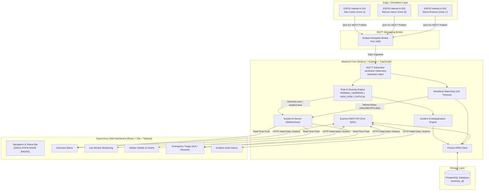
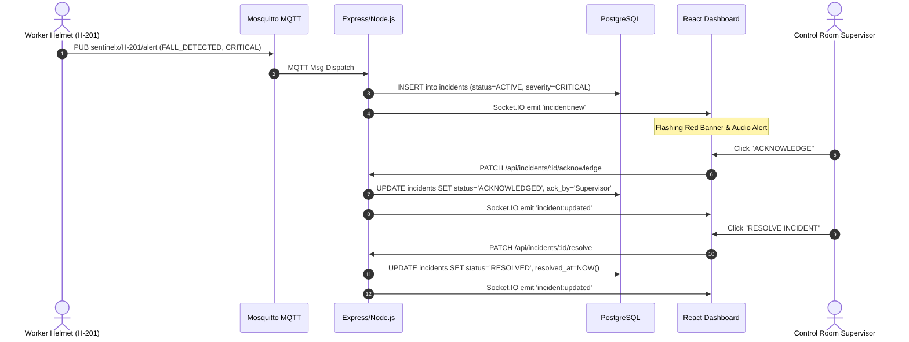

# SentinelX System Architecture Documentation

## 1. System Overview
**SentinelX** is an IoT-enabled industrial worker safety and emergency response platform tailored for hazardous environments such as mining pits, deep underground shafts, and heavy construction sites.

The software architecture is decoupled into four modular layers:
1. **Wearable Sensor Emulation Layer (Edge):** Emulates physical smart helmets (ESP32 + MAX30102 + MQ-5 + DHT11 + MPU6050 + SOS) via Python over MQTT.
2. **Ingestion & Messaging Broker:** Eclipse Mosquitto broker mediating publish/subscribe communication on dedicated topics.
3. **Application & Rule Engine Backend:** Node.js/TypeScript Express server executing schema validation, a deterministic rule & severity classification engine, duplicate prevention, a 10-second heartbeat offline detection watchdog, and Socket.IO broadcast.
4. **Supervisory Dashboard (Frontend):** Modern React (Vite + Tailwind CSS + Recharts) dark-themed interface delivering real-time telemetry gauges, interactive emergency triage, historical analytics, and audit filtering.

---

## 2. Architecture Diagram (Mermaid)

---

## 3. Communication Sequences

### Telemetry Pipeline
1. Simulated Helmet generates JSON payload with biometric (HR, SpO₂), environmental (Gas Raw, Temp, Humidity), and kinematic (Fall, Inactivity) metrics.
2. Packet is published to `sentinelx/{helmetId}/telemetry`.
3. Mosquitto forwards packet to Node.js backend.
4. Backend parses and validates JSON via Zod schema.
5. `HeartbeatService.recordPing()` updates helmet `lastSeen` timestamp and marks status `ONLINE`.
6. Reading is written to `SensorReading` table in PostgreSQL via Prisma.
7. `RuleEngineService` tests readings against safety thresholds.
8. If hazards exceed thresholds, an active incident is created (subject to deduplication).
9. Socket.IO broadcasts `telemetry:new` to connected dashboards.

### Emergency Alert & Response Sequence

